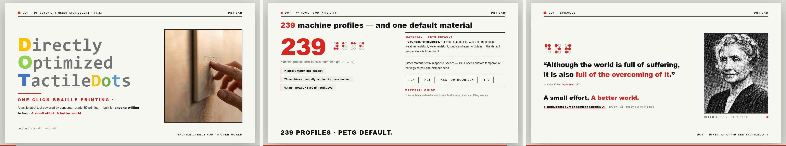

**English** | [简体中文](README.md)

# DOT — Directly Optimized TactileDots

**Want a quick overview first?** Click the cover to open the [16-page bilingual presentation](https://raymondzoufangzhen.github.io/DOT/DOT_Swiss_EN.html) — navigate with ←/→ arrow keys, switch EN/CN at the bottom-right corner.

> The name is the structure:
> **Directly** — help itself becomes effortless. Volunteers need no braille or slicing expertise: pick a printer, type text, get a printable file — the act of helping is low-barrier too.
> **Optimized** — for the fingertips of the helped. Purpose-built slicing makes the braille dots form and read better under 3D printing; this layer serves the blind reader's experience.
> **TactileDots** — the direct carrier. Touchable braille dot labels, one by one.

Turns text into braille G-code that can go straight to a 3D printer — English letters, digits and common symbols are supported, and even Chinese characters, so you can print braille labels in English or Chinese. Built for Klipper and Bambu Lab platforms, with 239 printer profiles included.

Type text → preview the dots live → export G-code → send it to the printer.

---

## Download

**Get the latest build from [Releases](https://github.com/raymondzoufangzhen/DOT/releases/latest)**

| File | Notes |
|---|---|
| `DOTv1.23.exe` | **Latest**, Windows 10 / 11 (64-bit), about 18 MB |
| `DOTv1.22.exe` | Previous version, still downloadable |
| `DOTv1.21.exe` | Older version, still downloadable |
| `DOTv1.2.exe` | Older version, still downloadable |

Every release keeps its own build and documentation — older versions are never overwritten: [all releases](https://github.com/raymondzoufangzhen/DOT/releases).

> **What's new in V1.23**: the dot preview now has editable pinyin labels. Polyphonic characters with competing readings always show full pinyin plus a numeric tone; other Chinese characters stay hidden until clicked. Click again to cycle through **all** candidate readings of a polyphonic character (e.g. 长 zhǎng → cháng); single-reading characters do not cycle — click the pinyin itself to type a reading. A new setting offers *minimal* vs *full* annotation, where full mode shows every pinyin while keeping ambiguous polyphonic characters highlighted in yellow. The chosen reading flows through the same conversion path so the preview, G-code and STL stay in sync. See the [V1.23 notes](docs/README-v1.23.en.md).

Single-file portable build. No installer, no Python, no runtime libraries. Copy it anywhere and double-click.

> If Windows SmartScreen blocks the first launch, click *More info* → *Run anyway*. The executable is not code-signed, which is the normal prompt for unsigned binaries.

---

## Features

- **Braille conversion for mixed text**: English letters (a–z with capital/small signs), digits (number sign + a–j) and common punctuation / math symbols map directly; even Chinese characters are supported, following the current national braille standard with tones applied by rule and polyphonic characters using their most common reading — English and Chinese labels are both supported, including mixed text.
- **Dome-shaped dots**: each dot is a dome rather than a cylinder, which forms reliably under a 0.4 mm nozzle, gives a crisp tactile feel and does not slip under the finger.
- **Two size presets**: the standard preset for everyday reading; a *jumbo* preset with roughly 1.4× larger dot spacing and dot diameter for teaching, demonstrations, or wherever a larger cell is needed.
- **Base plate and nozzle wipe included**: the base plate, inter-layer wipe path and object-exclusion commands are generated together, so the export is already a complete printable file.
- **G-code export, STL optional**: print the G-code directly; export STL when you need further processing.
- **"6 processes" test coupon**: a built-in calibration part for comparing forming quality on your own machine and dialling in its parameters.
- **GUI**: live dot preview, character limit computed from the current machine's printable width, Chinese/English interface, light/dark theme following the system.
- **Editable pinyin labels**: polyphonic characters with competing readings always show full pinyin plus a numeric tone. Other Chinese characters keep a transparent placeholder until clicked; click again to cycle through **all** candidate readings of a polyphonic character (e.g. 长 zhǎng → cháng). Single-reading characters do not cycle tones — edit the pinyin itself when needed. The dot pattern, G-code and STL all follow the selected reading.

---

## Supported printers

**239 machines across 47 brands**, including Creality, Elegoo, Voron, Sovol, Anycubic, Flashforge, Snapmaker, Bambu Lab, QIDI, RatRig, TwoTrees, FLSun, Cubicon and Vivedino.

Prerequisites:

| Item | Requirement |
|---|---|
| Firmware | Klipper dialect (relies on `SET_VELOCITY_LIMIT`, `EXCLUDE_OBJECT`, G2/G3 arcs, M83 relative extrusion); Marlin / RRF are not supported yet |
| Build volume | Printable width and depth both ≥ 150 mm |
| Nozzle | 0.4 mm |

Bambu Lab P1P / X1 / A1 / A1 mini / H2D go through the vendor's own channel: raw G-code can be submitted via Bambu Connect or LAN developer mode.

Marlin, RepRapFirmware and Repetier dialect machines are not supported.

---

## Usage

1. Double-click `DOTv1.23.exe`
2. **Settings → Printer** → pick your machine in the dialog that opens (brands on the left, models on the right, with search)
3. Type your text and check the dot layout and line count in the preview; click a Hanzi to reveal its pinyin (polyphonic: cycle readings), or click the pinyin itself to edit it
4. Export, then copy the G-code to the printer

**For a first run, print the "6 processes" test coupon first** and confirm Z-offset and flow before printing real content; braille dots are far more sensitive to first-layer height than ordinary models.

---

## Default temperatures

The program ships with **240 °C nozzle / 75 °C bed**, and those values are set up **for PETG**.

| Material | Nozzle | Bed |
|---|---|---|
| **PETG** (default) | 240 °C | 75 °C |
| PLA | 200–210 °C | 55–60 °C |

**Lower the temperature before printing PLA.** At 240 °C PLA strings and oozes, and a 75 °C bed makes it elephant-foot and cling to the plate. Both values are editable in the settings window; the accepted range is 180–260 °C nozzle and 0–100 °C bed.

### Why PETG is the default

This program outputs **thin, small braille labels with little text**: typically signage in outdoor public areas, and also labels stuck up in everyday indoor settings. Outdoors, resistance to sun and moisture matters; indoors, low odour and easy availability matter more. The labels are thin, small and quick to print, so reliability takes priority over material cost. PETG is the default on a "widest coverage" basis: it resists water and weathers better than PLA, is tough enough to bend rather than snap under impact, and hard enough for repeated fingertip contact; it prints without warping, gives off little odour, and needs neither an enclosure nor extra ventilation. The 240 °C / 75 °C default sits in its normal range, so it works out of the box — covering both outdoor and indoor use.

That does not make PETG the best choice in every situation. For specific needs, other materials have real advantages:

- **PLA** is the easiest to print and comes in the widest range of colours, good for indoor household labels and quick prototypes; but it is brittle — it tends to split along layer lines or shatter on impact — and weathers poorly, with sunlight and humidity accelerating hydrolysis. It is a poor fit for labels left outdoors in public areas.
- **TPU** is elastic in a way PETG cannot be, suited to labels that must bend or stick to uneven surfaces; but it is demanding on the feed mechanism. This program targets standard Klipper machines and does not adapt the feeder.
- **ABS** is stronger and more heat-resistant than PETG, but has largely given way to it in the consumer market, with fewer brands and colours, and its fumes require ventilation or an enclosure in both public and indoor spaces.
- **ASA** beats PETG on UV and heat resistance, making it the best match for labels under long-term outdoor sun — which is exactly the public-area use case; but it usually needs a 90–110 °C bed, at or beyond this program's 100 °C ceiling, plus an enclosure and ventilation. The material fits the scene, but the program's temperature range cannot reach it; if you do need ASA, tune the settings yourself and mind the ventilation.

Since no single material suits every situation, the program defaults to PETG for the common case while leaving the nozzle and bed temperatures editable, so you can set them to the normal range of whatever material you choose (see the PLA example above). Other materials (wood-fill, carbon-fill and so on) are likewise only exposed through the temperature fields, to be set by yourself.

---

## Caveats

1. `printer.cfg` must enable `[gcode_arcs]` and `[exclude_object]`. This is a hard prerequisite — the program can only warn, it cannot set this for you.
2. Seven profiles were manually checked against a real `printer.cfg`. A further **68 profiles** have their start/end macros cross-checked across two or more independent vendor presets (21 of those match the macros the program emits line for line; 5 overlap with the manually checked set), for a combined coverage of 70 profiles. The printer picker shows the check level. **Cross-checking only proves agreement between presets — it does not replace checking your actual `printer.cfg`**, since macro signatures differ between firmware versions.
3. The nozzle is fixed at 0.4 mm. Switching to 0.6 / 0.8 mm would ruin the dot shape, so the option is not offered.
4. The built-in self-check only guarantees internal consistency of structure, temperature, coordinates and extrusion budget. **It does not replace calibration on the machine.**
5. Bambu's `.gcode.3mf` packaging has not been tested on hardware. Confirm with the vendor slicer that the file channel accepts raw G-code before relying on it.

---

## Version

**V1.23** (current)

- Preview pinyin labels are now clickable: polyphonic characters cycle through every candidate reading on each Hanzi click; single-reading characters only reveal their pinyin and are edited by hand.
- A new **Minimal / Show all** setting controls pinyin visibility: Show all keeps every reading visible while ambiguous polyphonic characters stay yellow-highlighted. The selected reading flows through the same conversion path for preview, G-code and STL.
- Eleven regression tests bring the automated suite to **67 passing tests**; all seven EXE self-check samples pass.

**V1.22**

- Printer pool grows to **239 machines across 47 brands**: fixed the printable-area string parser that silently dropped 12 Klipper machines, and added 13 more machine profiles
- Every new profile passes the built-in self-check (239/239). When a converted start block is empty, a neutral heating/homing skeleton is used instead of sending `START_PRINT` to machines that do not define it
- Profiles now carry `dialect` and `source_version` fields, plus a dialect hook in the generation path. Klipper output is byte-identical; Marlin-only conversions are declared centrally, and G2/G3 arcs fail loudly until a safe flattening pass exists
- All 214 original machines were compared byte-for-byte: no G-code changed. Window title reports V1.22
- Macro verification coverage grows from 7 to **70 machines**: the official Elegoo / Anycubic / Flashforge forks were added as independent preset sources, with a side-car `cross_check.json` recording each machine's check level and the printer picker showing it directly. Verification data is metadata only — no G-code byte changed

Previous versions:

| Version | Notes | Docs | Build |
|---|---|---|---|
| **V1.23** | Current: editable pinyin labels in the preview | [README-v1.23.en.md](docs/README-v1.23.en.md) | `DOTv1.23.exe` |
| V1.22 | 239 machines, four-source merge, dialect groundwork | [README-v1.22.en.md](docs/README-v1.22.en.md) | `DOTv1.22.exe` |
| V1.21 | First-key warm-up, faster self-check, single-source geometry | [README-v1.21.en.md](docs/README-v1.21.en.md) | `DOTv1.21.exe` |
| V1.2 | 214-printer pool, dynamic character limit, dedicated printer window, Chinese/English UI | [README-v1.2.en.md](docs/README-v1.2.en.md) | `DOTv1.2.exe` |

---

## Feedback

If something fails, a machine profile doesn't fit, or a macro doesn't match, please open an [issue](https://github.com/raymondzoufangzhen/DOT/issues) and include the machine name plus the corresponding `START_PRINT` / `PRINT_END` macro definitions from your `printer.cfg` so it can be traced.

---

## License

Closed source, all rights reserved. Free to use for personal, teaching and other non-commercial purposes; unmodified copies may be shared free of charge; redistributing modified versions, decompilation, reverse engineering and any commercial use are not permitted.

See [LICENSE](LICENSE) for the full terms, which govern.

Dot positions follow the current Chinese national braille standard; the dot geometry and its parameters are this project's own implementation.
