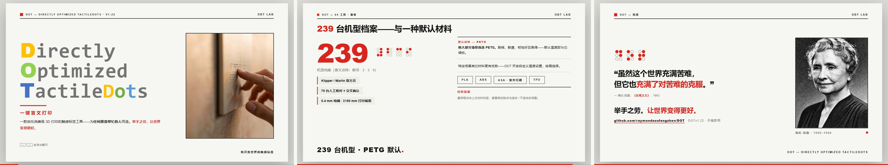

[English](README.en.md) | **简体中文**

# 一键盲文打印 · DOT

**想先快速了解项目？** 点击封面查看 [16 页双语在线演示文稿](https://raymondzoufangzhen.github.io/DOT/DOT_Swiss_EN.html)——键盘 ←/→ 翻页，右下角可切换中英文。

**DOT** — Directly Optimized TactileDots

> 名字即结构：
> **Directly**——让帮助者的行动无障碍。志愿者不需要懂盲文、也不需要懂切片，选机型、输文字就能得到可打印文件——帮助这件事本身也是低门槛的。
> **Optimized**——为被帮助者的指尖优化。专门的切片策略让盲文凸点在 3D 打印下成型更好、触读更清晰，这一层指向盲人的感受。
> **TactileDots**——项目的直接载体。一枚枚可触摸的盲文凸点标签。

把文本转成可直接送去 3D 打印的盲文 G-code——汉字、英文字母、数字与常用符号都支持，中文标签、英文标签都能打。面向 Klipper 与拓竹平台，内置 239 台机型配置。

输入文字 → 实时预览点位 → 导出 G-code → 交给打印机。

---

## 下载

**前往 [Releases](https://github.com/raymondzoufangzhen/DOT/releases/latest) 下载最新版**

| 文件 | 说明 |
|---|---|
| `DOTv1.23.exe` | **最新版**，Windows 10 / 11（64 位），约 18 MB |
| `DOTv1.22.exe` | 上一版，保留可下载 |
| `DOTv1.21.exe` | 更早版本，保留可下载 |
| `DOTv1.2.exe` | 更早版本，保留可下载 |

各版本的程序与文档并存，旧版不会被覆盖：[全部版本](https://github.com/raymondzoufangzhen/DOT/releases)。

> **V1.23 更新**：点阵预览新增可调拼音标签——发音有疑义的多音字常显全拼+调号，其余汉字点开后才显示；再点汉字时，多音字轮换全部候选读音（如「长」zhǎng→cháng），单音字不轮换、改读音请点拼音区手工输入。设置里新增「极简标音 / 全部标音」，全部标音常显所有拼音且疑义多音字仍黄色高亮。读音统一进入转换链，预览、G-code 与 STL 同步一致。详见 [V1.23 说明](docs/README-v1.23.md)。

单文件绿色版，免安装，不依赖 Python 或任何运行库。复制到任意目录双击即可运行。

> 首次运行若被 Windows SmartScreen 拦截，点「更多信息」→「仍要运行」。程序未做代码签名，这是未签名可执行文件的常规提示。

---

## 功能

- **中英混排盲文转换**：汉字按现行盲文国标点位输出，声调按规则标注，多音字按首选读音处理；英文字母（a–z，含大小写号）、数字（数号 + a–j）与常用标点、数学符号直接映射——中文标签、英文标签乃至中英混排都支持。
- **穹顶形凸点**：凸点做成穹顶而非圆柱，0.4 mm 喷嘴下成型稳定、触感明确、不打滑。
- **两种几何规格**：常规规格用于日常触读；大号规格（jumbo）点距与点径放大约 1.4 倍，适合教学演示或需要更大字号的场合。
- **自动基座与擦嘴轨迹**：连同底板、层间擦嘴路径、对象排除指令一起生成，导出的就是完整可打印文件。
- **导出 G-code，可选 STL**：G-code 直接打印；需要二次处理时可再导出 STL。
- **「6 工艺」测试片**：内置标定件，用于上机对比成型效果、确定本机参数。
- **图形界面**：实时点位预览、字数上限按当前机型可打印宽度动态计算、中英文界面切换、浅色/深色主题跟随系统。
- **可调拼音标签**：发音有疑义的多音字常显全拼+数字调号；其它汉字先透明占位，点汉字后显示全拼。再点汉字时，多音字轮换全部候选读音（如「长」zhǎng→cháng）；单音字不轮换，需要改时点拼音区手工输入。点阵、G-code 与 STL 同步更新。

---

## 支持机型

**239 台 / 47 个品牌**，覆盖 Creality、Elegoo（智能派）、Voron、Sovol、Anycubic、Flashforge（闪铸）、Snapmaker（快造）、Bambu Lab（拓竹）、QIDI、RatRig、TwoTrees、FLSun、Cubicon、Vivedino 等。

前置条件：

| 项目 | 要求 |
|---|---|
| 固件 | Klipper 方言（依赖 `SET_VELOCITY_LIMIT`、`EXCLUDE_OBJECT`、G2/G3 圆弧、M83 相对挤出）；Marlin / RRF 机型暂不支持 |
| 可打印区 | 宽、深均 ≥ 150 mm |
| 喷嘴 | 0.4 mm |

拓竹 P1P / X1 / A1 / A1 mini / H2D 走厂商私有通道：裸 G-code 可通过 Bambu Connect 或 LAN 开发者模式提交。

Marlin、RepRapFirmware、Repetier 方言机型不在支持范围。

---

## 使用

1. 双击 `DOTv1.23.exe`
2. **设置 → 机型** → 在弹出窗口中选择你的打印机（左侧按品牌、右侧按型号，支持搜索）
3. 输入文字，在预览区确认点位与行数；点汉字可显示/轮换多音字读音，点拼音区可手工修改
4. 点导出，得到 G-code，拷到打印机打印

**首次使用建议先打「6 工艺测试片」**，确认 Z-offset 与流量合适后再打正文；盲文凸点对首层高度比普通模型更敏感。

---

## 默认温度

程序默认 **喷嘴 240 °C / 热床 75 °C**，这套参数是**按 PETG 设定**的。

| 材料 | 喷嘴 | 热床 |
|---|---|---|
| **PETG**（默认） | 240 °C | 75 °C |
| PLA | 200–210 °C | 55–60 °C |

**打 PLA 前必须先改温度**：240 °C 会让 PLA 拉丝、渗料，75 °C 热床容易压出象脚、粘连底板。温度在设置窗口里直接改，允许范围 180–260 °C / 热床 0–100 °C。

### 为什么默认选 PETG

本程序输出的是**薄、小、字数少的盲文标签**：典型用于室外公共区域的标识，也兼顾室内生活场景的粘贴。室外要经得起日晒与潮湿，室内则看重低气味和易得性；标签又薄又小，打印量不大，可靠性比材料成本更值得优先。默认选 PETG 是"覆盖面优先"的取值：它耐水、耐候性优于 PLA，韧性好、受冲击时弯曲吸能而不易脆裂，硬度和耐磨性足以承受反复触摸；打印不翘边、气味小，无需封闭腔体或额外通风；240 °C / 75 °C 正好落在常规区间，开箱即可用，室外与室内两类场景都能覆盖。

这不等于 PETG 在所有场景都最好。特定需求下，其它材料各有优势：

- **PLA**：最容易打印、颜色选择最多，适合室内生活标签和快速打样；但偏脆，受冲击易沿层裂开或碎裂，且耐候性差，日晒加潮湿会加速水解劣化——不适合长期放在室外公共区域。
- **TPU**：弹性是 PETG 替代不了的，适合需要弯折或贴附不平表面的标签；但对送料机构要求较高，本程序面向常规 Klipper 配置，未做送料系统适配。
- **ABS**：强度和耐温高于 PETG，但消费级市场已逐步被 PETG 取代，牌号和颜色变少；打印气味大，公共区域或室内粘贴都要考虑通风。
- **ASA**：耐紫外线和耐热性优于 PETG，对室外公共区域长期日晒的标签其实最对口；但热床通常要 90–110 °C，接近甚至超出本程序 100 °C 的温度上限，且需封闭腔体和通风——场景对得上，程序参数却够不到。确有需要时请自行调参并留意通风。

正因为没有一种材料通吃所有场景，程序默认 PETG 覆盖多数情况，同时把喷嘴和热床温度开放为可自定义项，你可以按所选材料的常规区间自行调整（见上表 PLA 示例）。其它材料（木质、含碳纤维等）同样只提供温度入口，需自行设定。

---

## 注意事项

1. `printer.cfg` 必须启用 `[gcode_arcs]` 与 `[exclude_object]`。这是硬前提，程序只能提示，无法代为设置。
2. 机型表中 7 台经过人工核对打印机的 `printer.cfg`；**68 台**的启动/结束宏在两个及以上独立的厂商预设间交叉确认（其中 21 台与程序实际发出的宏逐行一致，5 台与人工核对名单重叠），两类核对合计覆盖 70 台，机型选择窗口会标注核对级别。**交叉确认只证明预设之间一致，不替代对照实际 `printer.cfg`**，不同固件版本的宏签名可能不同。
3. 喷嘴固定 0.4 mm。换 0.6 / 0.8 mm 会破坏凸点形状，程序不提供该选项。
4. 程序内部自检只保证结构、温度、坐标与挤出收支自洽，**不替代上机校准**。
5. 拓竹的 `.gcode.3mf` 封装未做上机实测，建议先用官方切片软件确认文件通道是否接受裸 G-code。

---

## 版本

**V1.23**（当前版本）

- 点阵预览按疑义显示拼音：有疑义的多音字常显全拼+调号；其它汉字透明占位，点后才显示。多音字点汉字轮换全部候选读音，单音字不轮换、只显示拼音，需要改时手工输入
- 设置中新增「极简标音 / 全部标音」：极简按需显示，全部标音常显所有拼音且疑义多音字仍黄色高亮；点拼音区可手工输入全拼+调号。读音进入统一转换链，预览、G-code 与 STL 同步一致
- 新增 11 项回归测试，合计 **67 项自动化测试全部通过**；EXE 自检 7 个样本全部通过

**V1.22**

- 机型池扩至 **239 台 / 47 品牌**：修复新版预设的打印区字符串解析，找回被静默丢弃的 12 台；另扩充 13 台新机型
- 新增机型全部经过自检验证（239/239），启动块为空时改用中性归零与加热骨架，不再把 `START_PRINT` 发给没有这个宏的机器
- 机型表增加 `dialect` 与 `source_version` 溯源字段，并在生成链路加入方言转换钩子：Klipper 输出逐字节不变，Marlin 需要转换的指令集中声明，圆弧未实现安全折线前会明确报错而不是输出错误 G-code
- 原有 214 台的 G-code 逐台比对，字节完全一致；界面标题同步为 V1.22
- 启动/结束宏的核对覆盖从 7 台扩至 **70 台**：引入 Elegoo / Anycubic / Flashforge 官方分支作为独立预设源，旁挂 `cross_check.json` 记录每台核对级别，机型选择窗口直接显示；核对结果只元数据化，不改变任何 G-code 字节

历史版本：

| 版本 | 说明 | 文档 | 程序 |
|---|---|---|---|
| **V1.23** | 当前版本，可调拼音标签、多音字读音轮换与极简/全部标音 | [README-v1.23.md](docs/README-v1.23.md) | `DOTv1.23.exe` |
| V1.22 | 239 机型、四源合并、方言层准备 | [README-v1.22.md](docs/README-v1.22.md) | `DOTv1.22.exe` |
| V1.21 | 首键预热、自检提速、几何常量单源 | [README-v1.21.md](docs/README-v1.21.md) | `DOTv1.21.exe` |
| V1.2 | 214 机型池、动态字数上限、独立机型窗口、中英切换 | [README-v1.2.md](docs/README-v1.2.md) | `DOTv1.2.exe` |

---

## 反馈

使用中遇到问题、机型适配失败或宏不匹配，请开 [Issue](https://github.com/raymondzoufangzhen/DOT/issues)，附上机型名称与 `printer.cfg` 中对应的 `START_PRINT` / `PRINT_END` 宏定义，便于定位。

---

## 许可

本程序为闭源软件，版权保留。个人学习、教学与其他非商业用途可免费使用；允许向他人免费分享**未经修改的原样副本**；禁止再分发修改后的版本、反编译或反向工程、以及任何商业使用。

完整条款以 [LICENSE](LICENSE) 为准。

盲文点位依据中国现行盲文国家标准，点形与几何参数为本项目自有实现。
